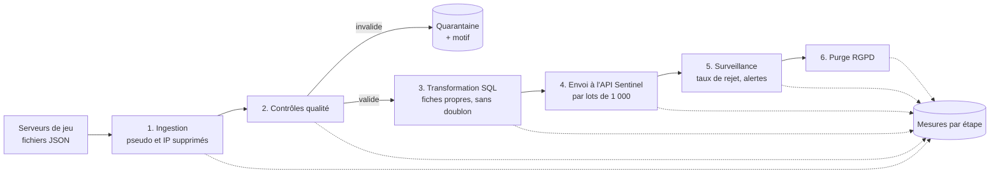

# Sentinel — Pipeline de données (bloc 3)

Pipeline qui alimente **Sentinel**, la détection de triche d'**Arena Strike** (jeu de tir
tactique 5v5 fictif du studio fictif Nebula Forge). Toutes les 5 minutes, il récupère les
fichiers de fin de match envoyés par les serveurs de jeu, les vérifie, les nettoie, les
range dans Postgres et les envoie à l'API Sentinel ([bloc 4](https://github.com/noahsgds/bloc4-ia-deploiement)).

> Projet réalisé pour la certification « Architecte en Intelligence Artificielle » (RNCP, niveau 7).
> Toutes les données sont synthétiques.

## Comment ça marche



| Étape | Ce qu'elle fait | En cas de problème |
|---|---|---|
| Ingestion | Lit les nouveaux fichiers (JSON ou CSV), retire le pseudo et l'adresse IP, copie les événements en base avec leur origine (fichier, heure, exécution) | Fichier illisible : mis de côté, alerte, les autres continuent. Donnée personnelle inattendue (ex. e-mail) : supprimée, alerte « prévenir le DPO » |
| Contrôles qualité | Vérifie chaque événement : champs obligatoires, identifiants, date, nombres et bornes, catégories | Événement invalide : quarantaine avec le motif en français, le reste continue |
| Transformation | SQL : du JSON brut vers une table propre au format de Sentinel | Doublon (même joueur, même match) : chargé une seule fois |
| Envoi | Envoie à `POST /predict` de l'API Sentinel les fiches pas encore transmises | API indisponible : nouvelle tentative automatique, seules les fiches manquantes sont renvoyées |
| Surveillance | Calcule le taux de rejet et la durée de l'exécution | Plus de 5 % de rejets ou plus de 2 minutes : alerte |
| Purge | Supprime les données au-delà de leur durée de conservation | — |

**Reprise automatique après erreur.** Chaque étape reprend ce qui reste à faire, même si
l'exécution précédente s'est arrêtée en route. Un fichier déjà enregistré n'est jamais
relu. Airflow réessaie 3 fois une étape en échec ; après le 3e échec, une alerte critique
est enregistrée.

## Structure du dépôt

| Dossier | Contenu |
|---|---|
| `dags/` | `sentinel_pipeline.py` : l'ordre des étapes, le planning (5 min), les nouvelles tentatives |
| `python/pipeline/` | `etapes.py` (les 6 étapes), `qualite.py` (règles de contrôle), `simulation.py` (serveurs de jeu simulés), `droits.py` (RGPD), `db.py`, `config.py` |
| `sql/` | `schema.sql` (tables), `transformer.sql`, `purger.sql` |
| `tests/` | 28 tests (pytest) : règles qualité, pipeline complet, reprise, envoi, alertes, purge, droits |
| `docker/` | Création de la base `pipeline` et du rôle en lecture seule |
| `.github/workflows/` | CI : style, tests, puis exécution réelle du DAG dans Airflow |

## Lancer le pipeline

Prérequis : Docker et Docker Compose.

```bash
cp .env.example .env              # puis remplacer les "change-me"
docker compose up -d --build      # Postgres + Airflow
```

1. Ouvrir Airflow : <http://localhost:8081>. Identifiant `admin` ; mot de passe :
   ```bash
   docker compose exec airflow cat /opt/airflow/simple_auth_manager_passwords.json.generated
   ```
2. Le DAG `sentinel_pipeline` démarre tout seul, toutes les 5 minutes (vue *Grid* : une
   colonne par exécution, une case par étape, verte si réussie).
3. Voir les résultats dans la base :
   ```bash
   docker compose exec postgres psql -U sentinel -d pipeline -c "SELECT * FROM pipeline.executions"
   ```

**Envoi à Sentinel :** démarrer l'API du bloc 4 (`docker compose up -d` dans son dossier),
puis renseigner `SENTINEL_API_URL` et `SENTINEL_API_KEY` dans `.env`. Sans adresse, l'envoi est
simplement désactivé.

**Commandes utiles :**

| Commande | Effet |
|---|---|
| `docker compose exec airflow python -m pipeline.simulation --events 2000` | Un serveur simulé dépose un fichier JSON (`--format csv` pour un fichier CSV) |
| `docker compose exec airflow python -m pipeline.droits --acces <player_id>` | Droit d'accès RGPD |
| `docker compose exec airflow python -m pipeline.droits --effacer <player_id>` | Droit à l'effacement RGPD |
| `pytest -v` | Tests (base de test : variable `TEST_DATABASE_URL`) |

**Dépannage :** une case rouge dans Airflow → cliquer dessus → *Logs* : le message dit
quelle étape a échoué et pourquoi. Les alertes sont aussi dans `pipeline.alertes`.

## Surveillance (critères 2.4 et 3.x)

| Où | Quoi |
|---|---|
| Interface Airflow | État de chaque étape de chaque exécution, durées, journaux, nouvelles tentatives |
| `pipeline.mesures` | Pour chaque étape : début, durée, lignes traitées, détails (rejets, doublons, taux de rejet) |
| `pipeline.executions` | Vue de synthèse : une ligne par exécution (lues, valides, rejetées, chargées, envoyées, durée) |
| `pipeline.alertes` | Fichier illisible, donnée personnelle inattendue, taux de rejet > 5 %, exécution de plus de 2 minutes, étape en échec |
| Rôle `lecture_seule` | Permet de brancher un outil de visualisation (par exemple le Grafana du bloc 2) sur ces tables sans pouvoir les modifier |

Ajouter une métrique = ajouter une clé dans les `details` renvoyés par une étape : elle est
enregistrée automatiquement, sans changer les tables.

## Performance (critère 1.1)

Mesuré sur un fichier de 30 000 événements (le volume d'une journée) :

| Étape | Durée |
|---|---|
| Ingestion | 1,9 s |
| Contrôles qualité | 2,1 s |
| Transformation | 1,1 s |
| **Total** | **5,1 s, soit environ 6 000 lignes par seconde** |
| Envoi à l'API Sentinel (avec les explications SHAP) | 13 s pour 29 391 fiches |

Un fichier toutes les 5 minutes contient environ 100 fins de match : le pipeline a une
marge de plus de 1 000 fois sa charge actuelle.

## Données personnelles (critères 6.x)

| Principe | Mise en œuvre |
|---|---|
| Minimisation | Pseudo et adresse IP supprimés dès l'ingestion, jamais stockés ; identifiants pseudonymes (UUID) |
| Détection de violation | Un champ personnel inattendu (e-mail, nom, téléphone…) est supprimé et déclenche une alerte critique pour le DPO |
| Sécurité | Secrets dans `.env` (non versionné) ; base accessible seulement depuis ce poste ; rôle `lecture_seule` pour la supervision ; SQL paramétré |
| Droits des personnes | Accès et effacement par `pipeline.droits`, chaque demande enregistrée dans `pipeline.demandes_rgpd` |
| Traçabilité | Chaque fiche garde son fichier d'origine, son exécution et sa date de chargement ; mesures et alertes horodatées |
| Conservation | Bruts et quarantaine 30 jours, fiches 6 mois, mesures et alertes 12 mois, purge automatique |
| Consentement | Non applicable : la base légale est l'intérêt légitime (voir le plan de gouvernance du bloc 1 et le RGPD du bloc 4) |

## Choix techniques

- **Airflow toutes les 5 minutes plutôt que Kafka (temps réel strict).** Les modérateurs
  examinent les dossiers dans la journée : 5 minutes de délai ne changent rien pour eux.
  Avec 30 000 fiches par jour (environ 0,3 par seconde), Kafka ajouterait une
  infrastructure lourde (courtiers, partitions) sans bénéfice. Si le volume ou le besoin
  changeaient, les étapes resteraient les mêmes : seule l'ingestion lirait un flux Kafka au
  lieu de fichiers.
- **SQL lancé par Airflow plutôt que dbt.** Une transformation et une purge ne justifient
  pas un outil de plus ; les fichiers SQL sont lisibles et testés.
- **Logique en Python pur, testée sans Airflow.** Le DAG ne fait que l'ordonnancement : la
  logique se teste en une seconde avec pytest, et la CI vérifie ensuite le DAG dans un vrai
  Airflow.
- **Redondance (critère 1.5).** Données sur un volume persistant, fichiers jamais supprimés
  avant leur enregistrement, étapes rejouables, nouvelles tentatives. Limite : un seul
  serveur ; en production, Postgres serait répliqué (bloc 2) et Airflow aurait plusieurs
  planificateurs.

## Usage de l'IA générative

Un assistant IA (Claude) a été utilisé pour l'accompagnement et la préparation de fichiers.
Les commits concernés portent la mention `Co-Authored-By: Claude`. Chaque choix a été relu,
compris et validé par l'auteur.
